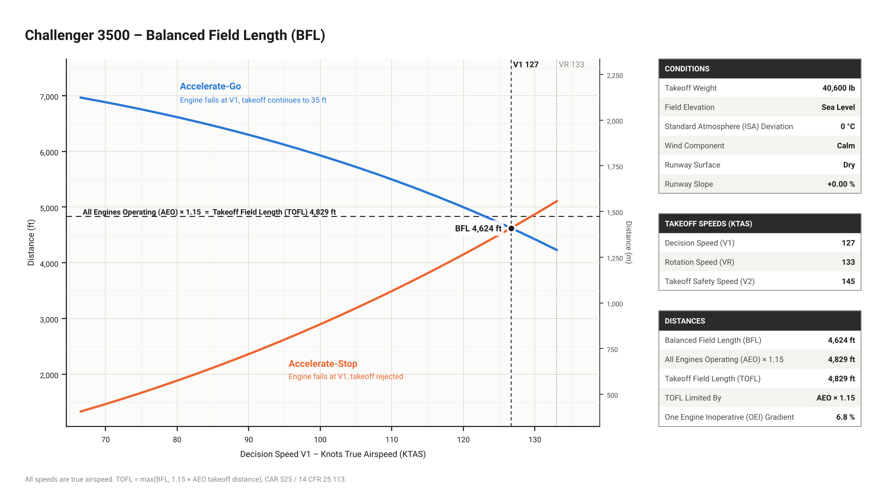
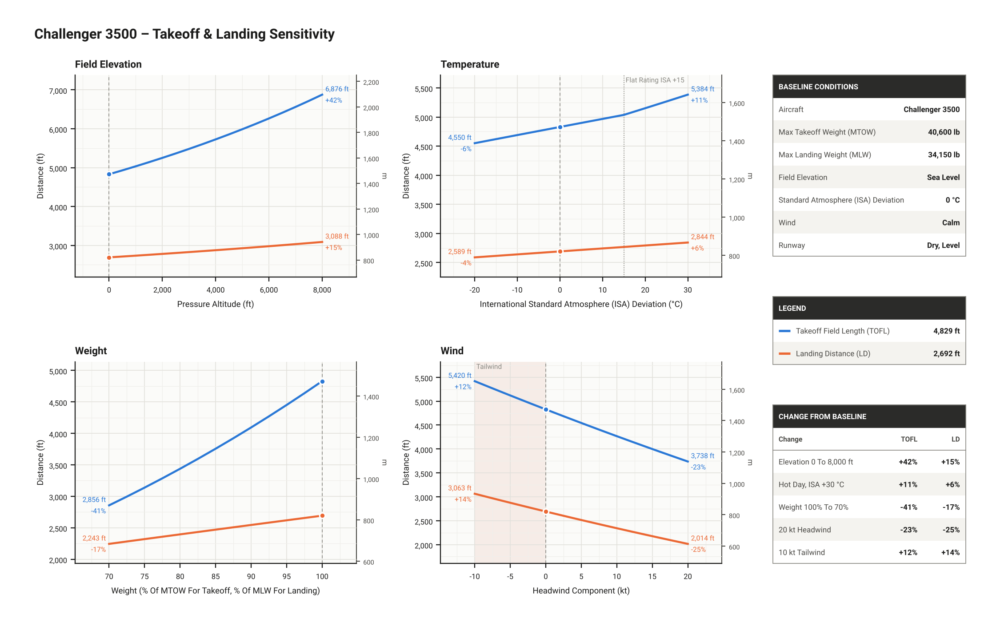

# Aircraft Performance Engine
*Takeoff & landing performance model for piston aircraft and business jets*

A Python model of takeoff and landing performance for piston aircraft and transport-category business jets. It covers **balanced field length with an engine failure at V1**, certified **takeoff field length**, landing distance, and **runway analysis** at real airports. The equations of motion are integrated numerically. One parameter per aircraft is calibrated to published data, and the remaining results are validated against the Cessna 172S POH, AOPA data for the Cirrus SR22T, and Bombardier's Challenger 3500 factsheet.

**Author:** Mark Barsoum
**Language:** Python 3 (NumPy, SciPy, Matplotlib)



---

## Features
- **Balanced field length (BFL).** One engine fails at V1. The model computes accelerate-go and accelerate-stop for each trial V1 and solves for the balanced V1 with `scipy.optimize.brentq`. Takeoff field length = max(BFL, 1.15 × all-engines TOD), per 25.113.
- **Runway analysis: "can I take off and land here today?"** Takes an aircraft, a runway, OAT, wind and runway condition, and checks TOFL ≤ TODA, ASD ≤ ASDA and LDR ≤ LDA. Wind is factored 50% headwind / 150% tailwind, per 25.105(d).
- **Built-in Bombardier sites, from real runway data:**
  - **CYYZ** Toronto Pearson (Global final assembly)
  - **CYMX** Montréal-Mirabel
  - **KICT** Wichita, home of the Bombardier Flight Test Center (BFTC)
- **Three built-in aircraft:** Cessna 172S, Cirrus SR22T (turbocharged) and Bombardier Challenger 3500.
- **Turbocharged piston model.** Power is held at sea-level value up to the critical altitude (`critical_alt_m`), then falls with density.
- **Flat-rated turbofan model.** Thrust is held constant up to ISA+15 °C, as on the Challenger 3500's HTF7350 engines.
- **Takeoff path:**
  - ground roll integrated with `scipy.integrate.solve_ivp`
  - rotation time, and the transition arc from liftoff to climb (Raymer's method)
  - screen height of 50 ft (Part 23) or 35 ft (Part 25 / CAR 525)
- **Landing:**
  - from 50 ft on a 3° glideslope
  - free roll, then braking roll
  - jets: ground spoilers and optional reverse thrust; LDR per 121.195
- **Runway slope and wet runways** in every calculation
- **Object-oriented design:**
  - an `Aircraft` base class with `PropAircraft` and `JetAircraft` subclasses
  - shared building blocks in `segments.py`
  - a custom exception hierarchy
- **Saved profiles:** aircraft and airports are created through menus and stored as JSON
- **Sensitivity study:** elevation, temperature, weight and wind

## Project structure
| File | Purpose |
|---|---|
| `main.py` | **Start here.** One menu for everything |
| `units.py` | Unit conversion functions |
| `atmosphere.py` | ISA model: temperature, pressure, density, σ, speed of sound |
| `aircraft.py` | `Aircraft` / `PropAircraft` / `JetAircraft`, built-in C172S, SR22T and Challenger 3500 |
| `exceptions.py` | `PerformanceError` and subclasses |
| `segments.py` | Building blocks: `Conditions`, `accelerate()`, `climb_to_screen()`, `decelerate()` |
| `takeoff.py` | All-engines takeoff distance |
| `bfl.py` | Balanced field length, takeoff field length, balanced-field chart |
| `landing.py` | Landing distance and LDR |
| `airports.py` | `Airport` / `Runway` classes, built-in CYYZ, CYMX, KICT, airport menu |
| `runway_analysis.py` | Takeoff and landing checks against a runway's declared distances |
| `profiles.py` | Aircraft profile menu and storage |
| `sensitivity.py` | Parameter sweeps and plots |
| `plot_style.py` | Shared chart style: Roboto, Title Case, Full Name (ABBR), solid axes, sidebar tables |
| `fonts/` | Roboto font files (Apache 2.0 licence in `fonts/ROBOTO_LICENSE.txt`), so charts look identical on any computer |
| `tests/` | pytest tests (run `python3 -m pytest`) |
| `LICENSE` | MIT licence |
| `GLOSSARY.md` | **Every name, abbreviation and unit suffix in the code** |
| `REFERENCES.md` | Every textbook, regulation and data source, with what each is used for |
| `report/performance_model.tex` | LaTeX methodology report: every formula and method, sectioned by Python file and function, with worked examples for the Challenger 3500 and SR22T (PDF included) |
| `flowcharts/flowcharts.html` | Editable flowcharts: calculation flow (one runway check) and program flow (`main.py` menu loop). Open in any browser to rearrange boxes |
| `flowcharts/make_flowcharts.py` | Exports the flowcharts to `calculation_flow.png`, `program_flow.png` and `flowcharts.pdf`. Run `python flowcharts/make_flowcharts.py` (needs Playwright) |
| `report/make_examples.py` | Runs the model and writes the worked-example LaTeX files and BFL figure. Run `python3 report/make_examples.py`, then compile the report with pdfLaTeX three times |

## How to run
```bash
pip install -r requirements.txt
python3 main.py
```
```
==============================================================
  AIRCRAFT PERFORMANCE ENGINE: TAKEOFF & LANDING
  Aircraft: Challenger 3500 (jet, 2 eng)    Runway: CYYZ 05
==============================================================
  1. Aircraft profiles (create / view / select / delete)
  2. Airports & runways (create / view / select / delete)
  3. Runway analysis: can I take off and land here today?
  4. Balanced field length (engine failure at V1)
  5. Takeoff calculation (all engines)
  6. Landing calculation
  7. Sensitivity plots
  8. Quit
```

### Example: runway analysis
```
  Challenger 3500 at CYYZ RWY 05   (DRY runway)
  Elevation 569 ft   OAT 25 °C (ISA+11)   slope -0.04%
  Wind 020°/15 kt: headwind 13 kt, crosswind 7 kt from the L
  Performance wind (50% head / 150% tail): +6.7 kt

  TAKEOFF at 40,600 lb  [balanced field (engine failure at V1)]
  V1 131   VR 137   V2 149 KTAS   OEI gradient 6.6%   (TOFL limited by AEO × 1.15)
  TOFL                       4,708 ft   vs TODA  11,120 ft   OK   (margin +6,412 ft)
  ASD                        4,492 ft   vs ASDA  11,120 ft   OK   (margin +6,628 ft)

  LANDING at 34,150 lb   VREF 122 KTAS   (unfactored LD 2,536 ft)
  LDR (dry ÷0.6)             4,227 ft   vs LDA  10,985 ft   OK   (margin +6,758 ft)

  TAKEOFF OK    LANDING OK
```

## Tests
```bash
pip install pytest
python3 -m pytest
```
The tests in `tests/` check the physics (ISA values, flat rating, one engine out), the
regulatory rules (wind factors, V1 ≤ VR, TOFL = max(BFL, 1.15 × TOD), LDR = LD / 0.6),
the two calibration targets (Challenger 3500 TOFL, SR22T ground roll), and that the
validation numbers below have not changed. Saving and loading profiles is tested against
a temporary file, so your own `aircraft_profiles.json` is never touched.

---

## Class design
```
Aircraft                        shared: lift(), drag(), stall_speed(), engine_fraction()
├── PropAircraft                thrust() = η·P/V capped at static thrust
│                               50 ft takeoff screen, 1 s rotation, 2 s free roll
└── JetAircraft                 thrust() = T_SLS·σ_eff^0.7·(1 − lapse·M), flat rated
                                cl_braking() = 0 (spoilers), reverse_thrust()
                                35 ft takeoff screen, 3 s rotation, 3 s free roll, LDR = LD/0.6
```
- `takeoff.py`, `bfl.py` and `landing.py` never check the aircraft type. Calling `acft.thrust()` runs the right model through **polymorphism**, and type-specific rules are **class variables**.
- All three build their results from the same segments in `segments.py`, so the equations of motion are written once.

## Naming conventions
Full definitions are in [GLOSSARY.md](GLOSSARY.md).
- **Units on every dimensional name:** `ground_roll_m`, `thrust_n`, `hw_kt`
- **Standard V-speeds:** `v1_mps`, `vr_mps`, `v2_mps`, `vref_mps`. **All speeds are TAS**, and output is labelled **KTAS**.
- **Industry abbreviations:** `tofl_m`, `bfl_m`, `asd_m`, `ldr_m`, `mtow_kg`, `sls_thrust_n`, `isa_dev_c`
- **Unit conversions through functions:** `ft_to_m()`, `mps_to_kt()`

---

## Method

### Atmosphere and thrust
$$T = T_{SL} - Lh + \Delta T_{ISA},\qquad p = p_{SL}\left(\frac{T_{SL} - Lh}{T_{SL}}\right)^{g_0/(LR)},\qquad \rho = \frac{p}{RT}$$

**Propeller:**
$$T = \min\left(\sigma T_{SLS},\ \frac{\eta\,\sigma P}{V}\right)$$

**Flat-rated turbofan.** The effective density ratio $\sigma_{eff}$ is evaluated at $\max(\Delta T_{ISA} - \Delta T_{flat}, 0)$:
$$T = T_{SLS}\,\sigma_{eff}^{0.7}(1 - k_{lapse}M)$$

**One engine inoperative:** thrust × (n − 1)/n.

### Ground roll (any engines, any slope)
$$m\frac{dV}{dt} = T - D - \mu(W - L) - W\sin\theta$$

### Takeoff
1. **Ground roll to VR** = 1.1 VS1, then **rotation** for 1 s (prop) or 3 s (jet).
2. **Air distance** (Raymer):
   - transition arc at $V_{TR} = 1.15\,V_{S1}$, load factor 1.2, radius $R = V_{TR}^2 / (0.2g)$
   - then a steady climb at $\sin\gamma = (T - D)/W$ up to the screen height

### Balanced field length
For each trial V1:
- **Accelerate-go:** all engines to V1; one engine inoperative from V1 to VR, through rotation and the OEI air distance to 35 ft.
- **Accelerate-stop:** all engines to V1; 2 s at V1 (25.109); then maximum braking with spoilers deployed, idle thrust, and no reverse credit.

`brentq` finds the V1 where the two distances are equal. That distance is the BFL, and
$$\text{TOFL} = \max(\text{BFL},\ 1.15 \times \text{TOD}_{AEO})\quad(25.113)$$

### Landing
1. **Air distance:** 50 ft to touchdown on a 3° glideslope at VREF = 1.3 VS0.
2. **Free roll:** 2 s (prop) or 3 s (jet) at VTD = 1.15 VS0.
3. **Braking roll:** integrated to a stop.

LDR = LD / 0.6, and × 1.15 if wet (121.195).

### Wind and runway analysis
- The state vector tracks ground speed; aerodynamics use TAS = GS + headwind.
- Runway analysis splits the reported wind into headwind and crosswind for the runway's true heading, then factors it: 50% of a headwind, 150% of a tailwind.

---

## Validation
Conditions: sea level, ISA, dry runway, no wind.

| Case | Model | Reference | Error |
|---|---|---|---|
| C172S takeoff ground roll, MTOW | 881 ft | 960 ft (POH) | −8% |
| C172S TOD over 50 ft, MTOW | 1,332 ft | 1,630 ft (POH) | −18% |
| C172S landing ground roll | 533 ft | 575 ft (POH) | −7% |
| C172S LD over 50 ft | 1,487 ft | 1,335 ft (POH) | +11% |
| **SR22T takeoff ground roll, MTOW** | **1,517 ft** | **1,517 ft (AOPA)** | **calibrated** |
| SR22T TOD over 50 ft, MTOW | 2,050 ft | 2,080 ft (AOPA) | −1% |
| SR22T landing ground roll | 822 ft | 1,178 ft (AOPA) | −30% |
| **Challenger 3500 TOFL, MTOW** | **4,829 ft** | **4,835 ft (Bombardier)** | **calibrated** |
| Challenger 3500 LD, no reverse, MLW 34,150 lb | 2,692 ft | 2,364 ft ("typical", Bombardier) | +14% |
| Challenger 3500 LD, no reverse, 28,000 lb | 2,424 ft | 2,364 ft ("typical") | +3% |

**How the Challenger was set up.**
- **Published data used:** MTOW, MLW, thrust (2 × 7,323 lbf) and the ISA+15 flat rating.
- **Estimated:** wing area (48.5 m²) and the aerodynamic coefficients.
- **Calibrated:** `cl_max_to` was the only value tuned, so that the TOFL matches Bombardier's 4,835 ft. This gives V1/VR/V2 ≈ 127/133/145 KTAS.
- **Independent check:** the landing distance was not tuned.
- **Why two weights:** Bombardier's landing figure is for a "typical" landing weight that isn't published, so the table shows both MLW and a lighter weight.

> **Sources.** Bombardier Challenger 3500 factsheet (2024) for thrust, flat rating and distances. AOPA and AeroCorner for MTOW and MLW. C172S POH performance charts. **Check reference values against your own copies before quoting.** Airport data is from OurAirports. Declared distances are approximated (TORA = TODA = ASDA = runway length, LDA = length − displaced threshold); the official values are in the CFS / FAA Chart Supplement. **Not for operational use.**

**Discussion**
- **TOFL is set by the all-engines case (× 1.15), just above the BFL.** For a twin with the Challenger's high thrust-to-weight, the two are close. Raymer's transition arc probably over-estimates the AEO air distance, so the true limiting case may be the BFL.
- **C172 TOD is under-predicted by 18%,** down from 32% before rotation and the transition arc were added. The constant-η propeller still over-predicts thrust.
- **Challenger LD at MLW is 14% long.** The 3° glideslope and 3 s free roll are conservative compared with certification flight-test technique.

## Sensitivity results
Only one variable is changed at a time. Jets use TOFL; the C172 uses TOD. LD has no reverse credit.

| Change from baseline | C172 TOD | C172 LD | CL3500 TOFL | CL3500 LD |
|---|---|---|---|---|
| Elevation 0 → 8,000 ft | +63% | +8% | +42% | +15% |
| Hot day, ISA+30 | +20% | +3% | +11% | +6% |
| Weight 100% → 70% | −41% | −9% | −41% | −17% |
| 20 kt headwind | −46% | −40% | −23% | −25% |
| 10 kt tailwind | +28% | +22% | +12% | +14% |

**Flat rating at work:** Challenger TOFL grows about 14 ft per °C up to ISA+15, then about 23 ft per °C above it, once the engines start losing thrust:

| ISA deviation | 0 | +10 | +15 | +20 | +30 |
|---|---|---|---|---|---|
| TOFL (ft) | 4,829 | 4,967 | 5,037 | 5,151 | 5,384 |



---

## Assumptions and limitations
- Engine failure at VEF = V1; no recognition delay before V1. VMCG is not checked.
- V-speed ratios fixed (VR = 1.1 VS1, V2 = 1.2 VS1); no separate VMU / VLOF schedule
- Wet runway: braking μ halved; Part 25 wet-runway takeoff rules (15 ft screen height, reverse credit) not modelled
- OEI climb gradient reported gear-down at V2; second-segment (gear-up) climb and WAT limits not yet computed
- Idle thrust taken as zero when braking; no brake energy limits
- Field elevation treated as pressure altitude (no QNH correction)
- Declared distances approximated (see Sources)
- Aircraft coefficients are engineering estimates, not manufacturer data

## Future work
- [ ] OEI second-segment climb gradient (2.4% for twins, 25.121) and WAT-limit charts
- [ ] VMCG check and VEF one second before V1
- [ ] Part 25 wet-runway takeoff rules
- [ ] KCAS ↔ KTAS so V-speeds compare directly with the AFM
- [ ] Official declared distances from the CFS / Chart Supplement
- [ ] Type hints

## References
Full citations, and what each source is used for, are in [REFERENCES.md](REFERENCES.md). Each file's header lists the sources it follows under **Basis**, and the code cites a source by key (e.g. `[RAYMER] Ch. 17`) where a specific constant or rule is used.

**Textbooks**
1. Anderson, J. D., *Aircraft Performance and Design*, McGraw-Hill, 1999. **[ANDERSON-APD]**
2. Anderson, J. D., *Introduction to Flight*, 8th ed., McGraw-Hill, 2016. **[ANDERSON-ITF]**
3. Raymer, D. P., *Aircraft Design: A Conceptual Approach*, 6th ed., AIAA, 2018. **[RAYMER]**
4. Torenbeek, E., *Synthesis of Subsonic Airplane Design*, Delft University Press, 1982. **[TORENBEEK]**
5. Filippone, A., *Advanced Aircraft Flight Performance*, Cambridge University Press, 2012. **[FILIPPONE]**
6. Mair, W. A. and Birdsall, D. L., *Aircraft Performance*, Cambridge University Press, 1992. **[MAIR-BIRDSALL]**
7. Ojha, S. K., *Flight Performance of Aircraft*, AIAA, 1995. **[OJHA]**
8. Gudmundsson, S., *General Aviation Aircraft Design*, Butterworth-Heinemann, 2014. **[GUDMUNDSSON]**

**Industry guidance, regulations and standards**
9. Airbus, *Getting to Grips with Aircraft Performance*, 2002. **[AIRBUS-GTG]**
10. 14 CFR Part 23; Part 25 (§25.105, .107, .109, .111, .113, .125); §121.195. Transport Canada CAR Standard 525.
11. ICAO Doc 7488, *Manual of the ICAO Standard Atmosphere*; ICAO Annex 14, *Aerodromes*.
12. NIST SP 811, *Guide for the Use of the International System of Units*.

**Data**
13. Cessna 172S *Pilot's Operating Handbook*; Bombardier *Challenger 3500 Factsheet* (2024); AOPA and AeroCorner Challenger 350 specifications; AOPA Cirrus SR22T specifications; OurAirports runway database.

## How this was built
I developed the physics and methodology, and I understand and can explain every part of the code: the object-oriented design, the NumPy and SciPy routines (`solve_ivp`, `brentq`) and the Matplotlib charting. This first version was built with AI coding assistance; I'm now rewriting it by hand, module by module, alongside completing my PCAP (Certified Associate in Python Programming) certification, expected December 2026.

## Licence
MIT, see [LICENSE](LICENSE). The bundled Roboto font is under the Apache 2.0 licence (`fonts/ROBOTO_LICENSE.txt`).
Not for operational use.
